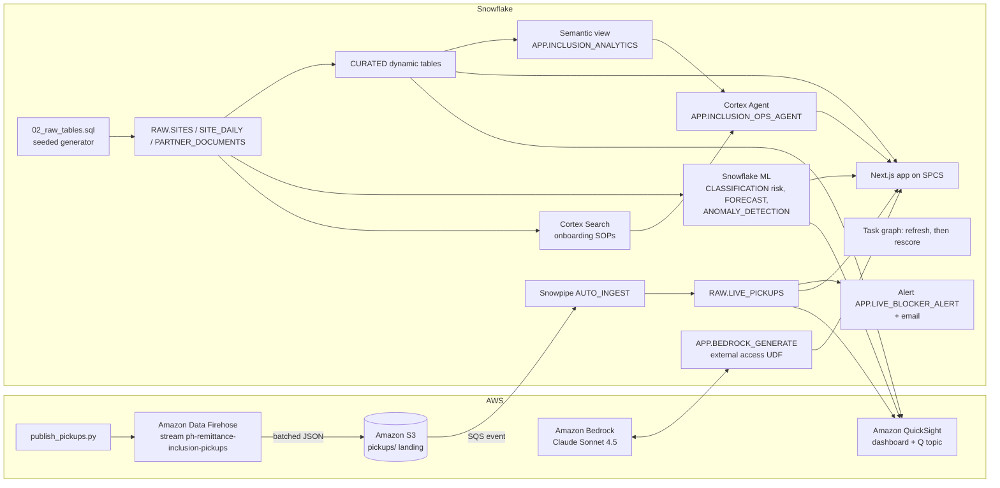

# Philippines Remittance Inclusion - Account Onboarding and Dropout Risk

Onboarding operations for the **remittance inclusion programme of a fictional Philippine rural bank: 40 remittance pickup sites across 5 cities** (Batangas City, Tacloban City, General Santos City, Angeles City, Naga City) using Snowflake, optionally with AWS. Remittance recipients who collect a payout are offered a basic savings account; the demo follows a live onboarding blocker to a 7-day abandoned-application risk score, an alert email and an AI action memo for the inclusion programme team.

## Architecture

An inclusion-programme pipeline built on **Snowflake** (Dynamic Tables, Snowflake ML, Cortex Search, Cortex Agent, Cortex AI_COMPLETE, SPCS) and, in the full build, **AWS** (Amazon Data Firehose, S3, Bedrock Claude, QuickSight + Amazon Q). Remittance pickup events from partner sites land in `RAW.LIVE_PICKUPS`. Dynamic tables curate 90 days of site-day history: remittance pickups and payouts, savings accounts opened, onboarding blockers (missing valid ID, proof of address gaps, eKYC selfie mismatches, core banking timeouts and more), blockers that ended in abandoned applications, same-day SLA breaches, and dormant-account follow-up completion. Snowflake ML scores 7-day abandoned-application risk per site, forecasts programme-wide blocker volume and flags eKYC error-rate anomalies. A Cortex Agent answers questions with SOP citations, and an LLM drafts the programme action memo.

Interactive diagrams (hover for object names): [Snowflake only](docs/architecture-snowflake.html) | [AWS + Snowflake](docs/architecture-aws.html). The app shows both on its Architecture & Data tab, the current build first. Regenerate them with `python3 docs/build_architecture.py aws snowflake`.



The Snowflake-only build drops the AWS subgraph: `APP.SIMULATE_PICKUPS` writes to `RAW.LIVE_PICKUPS`, and the app calls Cortex `AI_COMPLETE` instead of the Bedrock UDF.

## Snowflake Capabilities

| Capability | Implementation |
|-----------|---------------|
| Dynamic Tables | `CURATED.KPI_SUMMARY`, `PERFORMANCE_SUMMARY`, `BLOCKER_SUMMARY`, `TREND_ANALYSIS` from the RAW tables |
| Snowflake ML | CLASSIFICATION 7-day abandoned-application risk (`ML.DROPOUT_RISK_SCORES`), 14-day blocker-volume FORECAST, eKYC error rate ANOMALY_DETECTION |
| Cortex Search | 14 synthetic onboarding-blocker SOPs (one per site format and blocker type) in `SEARCH.ONBOARDING_SOP_SEARCH` |
| Semantic View | `APP.INCLUSION_ANALYTICS` over sites, blocker types, daily totals and risk |
| Cortex Agent | `APP.INCLUSION_OPS_AGENT`: Cortex Analyst over the semantic view plus Cortex Search for SOP citations |
| Cortex AI | `AI_COMPLETE('claude-sonnet-4-5')` for grounded answers, and for the action memo in the Snowflake-only build |
| Alerts + Tasks | `APP.LIVE_BLOCKER_ALERT` logs BLOCKER events and sends email; task graph `TASK_REFRESH_CURATED`, then `TASK_RESCORE_RISK` |
| Snowpark Container Services | Next.js app `APP.PH_REMITTANCE_INCLUSION_APP` with 6 tabs: Executive Cockpit, Predictive, Controls, Live Pickups, Ask AI, Architecture & Data |
| Snowpipe | `RAW.LIVE_PICKUPS_PIPE` AUTO_INGEST from S3 (AWS build only) |

## AWS Services

Used only in the AWS + Snowflake build.

| Service | Role in Demo |
|---------|-------------|
| Amazon Data Firehose | Direct PUT stream `ph-remittance-inclusion-pickups` receives simulated remittance pickup events and writes batches to S3 |
| Amazon S3 | Landing bucket (`pickups/`). An event notification goes to the Snowpipe SQS queue |
| Amazon Bedrock | Claude Sonnet 4.5 writes the action memo, called from Snowflake through an external-access UDF |
| Amazon QuickSight | DIRECT_QUERY executive dashboard over Snowflake (daily blockers, abandoned applications by site, abandoned-application risk) |
| Amazon Q | Natural-language questions over the QuickSight topic `ph-remittance-inclusion-topic` |
| AWS IAM | Least-privilege roles for S3, Firehose and Bedrock |

## Personas

These personas are fictional.

| Persona | Role | Key Questions |
|---------|------|---------------|
| **Marivic Dela Rosa-Santos** | Head of Remittance Inclusion Programme | "Which onboarding blockers end in abandoned applications?" "How many remittance pickups turn into savings accounts?" |
| **Joel Ramirez Lim** | Onboarding Operations Analyst | "Which sites are high risk this week, and which SOP applies?" |

## Data

All data is synthetic and seeded, so every rebuild reproduces it. The rural bank, its partner sites and all names are fictional; only site-day aggregates are generated, with no customer-level or personal data.

| Table | Rows | Description |
|-------|------|-------------|
| RAW.SITES | 40 | Remittance pickup sites in 5 Philippine cities and 5 formats (Pawnshop branch, Rural bank branch, Cooperative office, Money transfer kiosk, Mall service desk), with risk tier and partner tenure |
| RAW.SITE_DAILY | 3,600 | Daily site observations over 90 days: remittance pickups, payouts (PHP), savings accounts opened, onboarding blockers, abandoned-application blockers, same-day SLA breaches, blocker type, dormant-account follow-ups, eKYC error rate and average onboarding time |
| RAW.PARTNER_DOCUMENTS | 40 | Required, on-file and pending partner accreditation documents per site |
| SEARCH.BLOCKER_DOCS | 14 | Synthetic onboarding-blocker SOPs indexed for Cortex Search |
| RAW.LIVE_PICKUPS | Grows during the demo | Live remittance pickup events from Firehose (AWS build) or `APP.SIMULATE_PICKUPS` (Snowflake-only build) |
| ML.DROPOUT_RISK_SCORES | 40 | 7-day abandoned-application probability and risk band per site |

## Build Instructions

### Prerequisites
- Snowflake account with ACCOUNTADMIN access, and Cortex AI enabled (AI_COMPLETE, Search, Agent).
- An X-Small warehouse with auto-suspend at or below 120 s, and an existing SPCS compute pool.
- Python 3.11+, `snowflake-connector-python`, Node.js 22+, Docker and the `snow` CLI.
- App image: run `snow spcs image-registry login`, then build and push `ph-remittance-inclusion-app:v1` to the database's `APP.IMAGES` repository (see the header of `snowflake/07_deploy_app.sql`).
- AWS build only: `boto3`, AWS credentials for the target account (us-west-2) with Bedrock access, and QuickSight Enterprise.

### SPCS App
```
<DATABASE>.APP.PH_REMITTANCE_INCLUSION_APP
```

### Tests
```bash
python -m pytest aws snowflake quicksight
```

For a local run, put `SNOWFLAKE_ACCOUNT`, `SNOWFLAKE_USER`, `SNOWFLAKE_DATABASE`, `SNOWFLAKE_WAREHOUSE`, `SNOWFLAKE_AUTHENTICATOR=PROGRAMMATIC_ACCESS_TOKEN`, `SNOWFLAKE_TOKEN` and `DEMO_PLATFORM` in the environment, then run `npm --prefix app run build && npm --prefix app start`.

## Build Modes

Both modes share the same core. They differ in three places, and the app's `DEMO_PLATFORM` setting (in its SPCS spec) switches the memo provider and the Live Pickups tab.

| Layer | Snowflake Only | Full AWS + Snowflake |
|---|---|---|
| Live pickups | `CALL APP.SIMULATE_PICKUPS(n)` inserts simulated remittance pickup events into `RAW.LIVE_PICKUPS`. This simulates a pickup event feed; it is not Snowpipe Streaming | `aws/publish_pickups.py` to Amazon Data Firehose, then S3, SQS and Snowpipe AUTO_INGEST |
| Action memo | Cortex `AI_COMPLETE('claude-sonnet-4-5')` | Amazon Bedrock Claude Sonnet 4.5 through `APP.BEDROCK_GENERATE` |
| BI and natural-language questions | The SPCS app is the dashboard; questions go to the Cortex Agent | Also a QuickSight dashboard and an Amazon Q topic |
| App setting | `DEMO_PLATFORM: snowflake` | `DEMO_PLATFORM: aws` |

### Snowflake Only

```bash
# 1. Core data and dynamic tables (guarded: new isolated database only)
python snowflake/run_core.py --database PHILIPPINES_REMITTANCE_INCLUSION_SNOWFLAKE --warehouse <XS_WAREHOUSE> --connection <CONNECTION> --apply
# 2. Native pickup feed, ML, search, semantic view, agent, alert and task graph
python snowflake/run_intelligence.py --database PHILIPPINES_REMITTANCE_INCLUSION_SNOWFLAKE --platform snowflake --warehouse <XS_WAREHOUSE> --connection <CONNECTION> --alert-email you@example.com
# 3. App on SPCS with DEMO_PLATFORM=snowflake (push the image first)
python snowflake/run_intelligence.py --database PHILIPPINES_REMITTANCE_INCLUSION_SNOWFLAKE --platform snowflake --warehouse <XS_WAREHOUSE> --connection <CONNECTION> --alert-email you@example.com --files 07_deploy_app.sql --compute-pool <COMPUTE_POOL>
```

During the demo:
- Run `CALL APP.SIMULATE_PICKUPS(20)` to add live remittance pickup events. For a continuous feed, run `ALTER TASK APP.TASK_SIMULATE_PICKUPS RESUME`, and `SUSPEND` it afterwards.
- Run `EXECUTE ALERT APP.LIVE_BLOCKER_ALERT` to raise the alert email.
- Run `EXECUTE TASK APP.TASK_REFRESH_CURATED` to refresh the curated tables and rescore risk.

Afterwards, drop the database or run `ALTER SERVICE APP.PH_REMITTANCE_INCLUSION_APP SUSPEND`.

### Full AWS + Snowflake

```bash
# 1. Core data and dynamic tables (guarded: new isolated database only)
python snowflake/run_core.py --database PHILIPPINES_REMITTANCE_INCLUSION_AWS --warehouse <XS_WAREHOUSE> --connection <CONNECTION> --apply
# 2. AWS ingestion and Bedrock (dry run first, then --apply)
python aws/setup_aws.py --database PHILIPPINES_REMITTANCE_INCLUSION_AWS --account <AWS_ACCOUNT_ID> --connection <CONNECTION> --apply
# 3. ML, search, semantic view, agent, alert and task graph
python snowflake/run_intelligence.py --database PHILIPPINES_REMITTANCE_INCLUSION_AWS --platform aws --warehouse <XS_WAREHOUSE> --connection <CONNECTION> --alert-email you@example.com
# 4. App on SPCS with DEMO_PLATFORM=aws (push the image first)
python snowflake/run_intelligence.py --database PHILIPPINES_REMITTANCE_INCLUSION_AWS --platform aws --warehouse <XS_WAREHOUSE> --connection <CONNECTION> --alert-email you@example.com --files 07_deploy_app.sql --compute-pool <COMPUTE_POOL>
# 5. QuickSight dashboard and Q topic (needs an existing Snowflake data source)
python quicksight/build_dashboards.py --database PHILIPPINES_REMITTANCE_INCLUSION_AWS --account <AWS_ACCOUNT_ID> --principal-arn <QUICKSIGHT_USER_ARN> --data-source-arn <DATA_SOURCE_ARN> --prefix ph-remittance-inclusion --apply --update --with-topic
```

QuickSight objects must be shared with the QuickSight user who signs in (`--principal-arn`); otherwise the console shows nothing.

During the demo:
- Run `python aws/publish_pickups.py --count 20` to send live remittance pickup events. Firehose buffers for up to 60 seconds before writing to S3.
- Run `EXECUTE ALERT APP.LIVE_BLOCKER_ALERT` to raise the alert email.
- Run `EXECUTE TASK APP.TASK_REFRESH_CURATED` to refresh the curated tables and rescore risk.

Afterwards, `python aws/teardown_aws.py --database PHILIPPINES_REMITTANCE_INCLUSION_AWS --account <AWS_ACCOUNT_ID> --connection <CONNECTION> --apply` removes the AWS resources and the account-level Bedrock external-access and S3 storage integrations. It leaves the email integration `PH_REMITTANCE_INCLUSION_EMAIL_INT`, which the Snowflake-only build also uses.

## Business Impact

Industry research and Snowflake customer outcomes:
- **Account ownership in the Philippines nearly doubled**: "account ownership surged to 56 percent in 2021, up from 29 percent in 2019" -- [Bangko Sentral ng Pilipinas, More than 50% of Filipinos Now Own a Financial Transaction Account (2022)](https://www.bsp.gov.ph/SitePages/MediaAndResearch/MediaDisp.aspx?ItemId=6416)
- **Bank accounts are still the minority**: "the share of adults with a bank account also rose, almost doubling to 23 percent in 2021 from 12 percent in 2019" -- [Bangko Sentral ng Pilipinas, More than 50% of Filipinos Now Own a Financial Transaction Account (2022)](https://www.bsp.gov.ph/SitePages/MediaAndResearch/MediaDisp.aspx?ItemId=6416)
- **Missing documents remain an onboarding barrier**: "the lack of documents to open an account is still prevalent for a large segment of the population" -- [Bangko Sentral ng Pilipinas, More than 50% of Filipinos Now Own a Financial Transaction Account (2022)](https://www.bsp.gov.ph/SitePages/MediaAndResearch/MediaDisp.aspx?ItemId=6416)
- **NatWest** (Snowflake customer), one of Britain's largest retail and commercial banks, reports its 40-strong ESG team "was productive within two weeks rather than the traditional three-month onboarding period" on Snowflake -- [Snowflake customer story: NatWest](https://www.snowflake.com/en/customers/all-customers/case-study/natwest/)

## Key Demo Numbers

These figures are synthetic and come from the seeded demo data. Forecast and anomaly figures can shift slightly with the build day.

- **40 sites** in 5 cities across 5 formats, 3,600 site-days over 90 days; **843,634 remittance pickups** paying out PHP 6,512 M
- **24,629 savings accounts opened**, a pickup-to-account conversion of 2.92%
- **Blocker-free pickup rate 99.93%**: **607 onboarding blockers**, of which **207** ended in abandoned applications (blocker dropout rate 34.1%); **79 same-day SLA breaches**
- **Proof of address gap** produces the most abandoned applications (69 of 136 blockers); Naga City has the most abandoned applications of the 5 cities (61); the 16 area power interruption blockers always resolve without an abandoned application
- **Abandoned-application model** out-of-time holdout: precision 0.43, recall 0.28 at a 0.5 threshold, against a 0.250 base rate. Eight sites are high risk; the top site is RS-0009 (Pawnshop branch, Naga City), at 96.9%
- **14-day blocker forecast** with prediction intervals; **35 of 640** site-days flagged as eKYC error-rate anomalies
- **Dormant-account follow-up completion 73.2%**, partner document coverage 72.7%, with 20 documents pending
- **14 SOPs** indexed for Cortex Search and cited by ID in agent answers

## License

Apache 2.0 — See [LICENSE](LICENSE) for details.

This is a personal demo project and is not an official Snowflake offering. It comes with no support or warranty. Industry metrics cited are from publicly available third-party research and Snowflake customer stories; they represent reported outcomes and are not guarantees of results.
